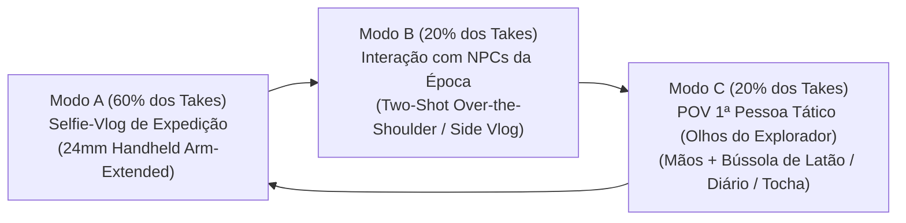

# Plano Mestre de Transformação do Canal — Formato *"I Traveled to the Past"* + Protagonista Estilo Indiana Jones

**Data:** 04/11/2026  
**Referência Analisada:** [`https://www.youtube.com/watch?v=MboDSmGCk_8`](https://www.youtube.com/watch?v=MboDSmGCk_8) — Canal **I traveled to the past** (`UCSIlTc3jhuxB9rh4GCAZoFA`)  
**Motor de Produção Local:** [`D:\CANAL 9\flowveo`](file:///d:/CANAL%209/flowveo) (Google Flow Automation + Start Frame $\rightarrow$ Veo 3.1 Video)

---

## Parte 1 — Engenharia Reversa Forense ("Debug") do Canal de Referência

### 1.1. Dados Técnicos Extraídos do Vídeo `MboDSmGCk_8`
- **Título:** `(POV) I Traveled Back in Time to the Titanic Before the Iceberg…`
- **Duração Exata:** `808 segundos` (`13m28s`)
- **Desempenho:** `21.692 views` (Top #1 recente do canal, seguido por *Red Sea Before Moses Split the Waters* com `14.548 views` e *Year 2000 that people in 1900 imagined* com `8.852 views`).
- **Descoberta Forense #1 — A Matemática dos 8 Segundos (Google Flow / Veo 3.1):**
  - `808 segundos ÷ 8,0 segundos = exatos 101 takes de 8 segundos` concatenados em corte seco.
  - Todos os cortes de cena e blocos de diálogo na faixa de legendas (`sub.en.vtt`) caem exatamente em múltiplos de `8.0s` (`00:00 -> 00:08 -> 00:16 -> 00:24 -> 00:32...`).
- **Descoberta Forense #2 — Vazamento do Prompt Interno da IA no Take 017 (`02:08–02:16`):**
  - Na transcrição oficial extraída de `MboDSmGCk_8` em `00:02:08.960`, a personagem fala literalmente em voz alta:
    > *"The user provided a specific script in the prompt. Didn't expect to feel this comfortable this quickly, but I kind of do."*
  - **O que isso prova:** O canal utiliza o **Google Veo 3 / Google Flow** gerando **vídeo + lip-sync + voz nativa + som ambiente** direto do prompt de texto/imagem, injetando instruções do tipo `Speak this specific script: "..."` em cada take de 8 segundos — e o operador publicou o vídeo sem auditar o áudio do Take 017.

---

### 1.2. A Mecânica Visual e de Retenção do Canal Concorrente
A inspeção dos `163` keyframes do storyboard (`storyboard_0.jpg` a `storyboard_17.jpg`) e da thumbnail (`video_thumb.jpg`) revela os 4 pilares do formato:

| Pilar | Como o Canal de Referência Faz | Impacto na Retenção |
| :--- | :--- | :--- |
| **1. Câmera Selfie-Vlog no Passado (`~85%` dos takes)** | Protagonista segura a câmera com um braço estendido à frente (`wide-angle 24mm selfie POV`), caminhando pelo cenário histórico enquanto olha para a lente e fala diretamente com o espectador. | Cria conexão parassocial imediata ("um youtuber/explorador real filmando dentro de 1912"). |
| **2. Interação Ao Vivo com NPCs (`~15%` dos takes)** | Em um único take de 8s do Veo 3.1, o protagonista faz uma pergunta a um figurante histórico (carregador de malas no Take 002, oficial no Take 003, camareira no Take 019) e o NPC responde com lip-sync. | Quebra a sensação de "fundo falso de IA" e prova que o personagem está fisicamente inserido na época. |
| **3. Ironia Dramática Constante** | O viajante sabe o que vai acontecer (*"Everyone here is so happy. They have no idea"*, *"Everything looks perfect. That's the problem"*). | Mantém a tensão psicológica mesmo em cenas calmas de exploração (salão de jantar, corredores, casa de máquinas). |
| **4. Thumbnail + Título de Curiosidade Extrema** | Selfie em grande-angular + expressão de choque + monumento/evento histórico gigante ao fundo em *Golden Hour* + 1 palavra gigante (`TITANIC`) + título `(POV) I Traveled Back in Time to [Evento] Before [Desastre]`. | Alto CTR orgânico em Browse Features e Suggested Videos. |

---

### 1.3. Os 4 Pontos Fracos Críticos do Concorrente (Nossa Vantagem Competitiva)
1. **Loop / Enchimento Desonesto na Metade Final (`08:00–13:28`):**
   - Dos Takes `001` a `060` (`00:00–08:00`), o vídeo segue uma linha lógica (embarque $\rightarrow$ cabine $\rightarrow$ jantar $\rightarrow$ baile 1ª classe $\rightarrow$ festa 3ª classe).
   - No **Take 061 (`08:00`)** e novamente no **Take 068 (`08:56`)**, o vídeo **volta para o cais de embarque de dia** colando takes descartados de outros testes, muda a cor do vestido da protagonista 4 vezes (verde $\rightarrow$ lilás $\rightarrow$ vinho $\rightarrow$ azul-veludo $\rightarrow$ branco) e **termina em `13:28` sem nunca mostrar o iceberg ou o naufrágio prometido no título!**
2. **Ausência de Identidade de Personagem Fixo:**
   - Cada vídeo do canal usa uma pessoa aleatória gerada pela IA (ora uma mulher de vestido verde, ora um homem de camiseta cinza, ora outro rosto). O público não cria vínculo com um apresentador/explorador recorrente.
3. **Zero Controle de Qualidade de Áudio/Prompt:**
   - Vazamentos de metatexto da IA (*"The user provided a specific script in the prompt"*) e falas truncadas no corte de 8s.
4. **Falta de Ação Física e Props de Aventura:**
   - O personagem apenas anda e comenta (*"Look at these walls, this wood is so smooth"*), sem missão tática, sem artefatos de viajante do tempo e sem clímax de sobrevivência.

---

## Parte 2 — Criação do Protagonista Fixo ("Pegada Indiana Jones")

### 2.1. Arquétipo e Posicionamento: **Dr. Jack Sterling ("O Crono-Arqueólogo")**
*(Nome ajustável conforme preferência — arquétipo: **Indiana Jones + Nathan Drake + Vlogueiro de Expedição Temporal**)*

- **Quem ele é:** Um arqueólogo de campo e explorador temporal que salta para as últimas horas antes dos maiores cataclismos, mistérios e impérios da história humana, portando uma **câmera de expedição blindada** e seu **Cronômetro-Bússola de Latão**.
- **Por que o visual Indiana Jones resolve o problema da Viagem no Tempo:**
  - Uma roupa moderna (camiseta/moletom) destrói a estética de épico histórico; já trocar de roupa a cada época destrói o reconhecimento visual do personagem nas thumbnails.
  - O traje **Indiana Jones (Chapéu Fedora surrado + Jaqueta de Couro marrom envelhecida + Camisa cáqui + Bolsa tiracolo de couro)** é **cinematográfico e camaleônico**: funciona perfeitamente no convés do Titanic (1912), nas ruas de Pompeia (79 d.C.), no Mar Vermelho (1250 a.C.), na Babilônia ou na Londres de 1666, mantendo **100% de identidade visual imediata**.

---

### 2.2. DNA Visual Invariante (Prompt Lock para Google Flow `Personagens` + `Start Frames`)

> **CHARACTER SHEET DNA (Inglês — Padrão para Nano Banana 2.1 / Midjourney / Flow Veo 3.1):**
> `Charismatic 36-year-old rugged male archaeologist-explorer in the style of classic Indiana Jones, sharp jawline, 3-day dark stubble beard, subtle small scar over right eyebrow, expressive hazel-green eyes, weathered sun-tanned skin with realistic sweat and dust texture. Wearing an iconic battered dark-brown felt fedora hat with pinched crown, a distressed vintage dark-brown leather expedition jacket over an unbuttoned sand-khaki cotton utility shirt with rolled sleeves, a worn brown leather crossbody satchel strap across his chest, and an antique brass chronometer-compass strapped to his left wrist.`

### 2.3. Personalidade, Tom de Voz e Atuação nos Takes de 8s
- **Tom de Voz:** Barítono médio-grave, energético, curioso, com humor seco sob perigo iminente (estilo aventureiro clássico que admira a grandiosidade arquitetônica do passado, mas sabe exatamente quantas horas faltam para o desastre).
- **Objetos de Cena (Props Recorrentes para POV de 1ª Pessoa):**
  1. **Cronômetro de Latão no Pulso:** Mostra a contagem regressiva para o evento histórico (ex.: `23:40` no Titanic, ou o tremor sísmico em Pompeia).
  2. **Diário de Couro Envelhecido (Field Journal):** Usado em takes POV de 1ª pessoa com mapas rabiscados à mão para se localizar na cidade/navio antigo.
  3. **Tocha de Resina / Lanterna de Latão:** Usada quando ele invade áreas restritas (catacumbas, porão de carga, templos subterrâneos).

---

## Parte 3 — Gramática de Câmera Híbrida (O Upgrade Cinematográfico)

Em vez de ficar 100% do tempo no mesmo ângulo estático, cada episódio do nosso canal alterna matematicamente entre **3 Ângulos de Câmera** dentro do [`StartFrameVideoWorkflow`](file:///d:/CANAL%209/flowveo/src/execution/start-frame-video-workflow.ts):



1. **Modo A — Selfie-Vlog de Expedição (`60%` dos takes):**
   - O Explorador de Fedora e jaqueta de couro segura a câmera com o braço estendido (`handheld wide-angle 24mm lens, extended arm selfie vlog perspective`), caminhando pelo cenário histórico monumental ao fundo e falando diretamente com o espectador (lip-sync nativo).
2. **Modo B — Interação Direta com NPCs Históricos (`20%` dos takes):**
   - Enquadramento `Medium Two-Shot Handheld`: nosso Explorador aborda um personagem da época (um legionário romano, um oficial do Titanic, um mercador babilônico, um médico da peste) para pedir informação, subornar a passagem ou alertar sobre o perigo, com resposta falada do NPC no mesmo take de 8s.
3. **Modo C — POV 1ª Pessoa Tático (`20%` dos takes — Estilo Sobrevida / Indiana Jones):**
   - Câmera nos olhos do Explorador (`first-person eyesight POV`), mostrando suas mãos com a manga da jaqueta de couro e o cronômetro de latão tocando nas estruturas, abrindo o diário de couro, destrancando portas proibidas ou correndo entre destroços.

---

## Parte 4 — Estrutura Narrativa de 5 Atos (Eliminando o "Loop Falso" do Concorrente)

Diferente do canal de referência (que repete o embarque no minuto `08:00` e termina sem clímax), todos os nossos episódios terão um **Arco de Expedição Completo e Cronometrado** (para vídeos de **8 a 13 minutos**, equivalentes a **60 a 100 takes de 8s**):

| Ato | Janela de Tempo (Ex.: 12 min / 90 Takes) | Nome do Ato | O que Acontece na Tela |
| :--- | :--- | :--- | :--- |
| **Ato 1** | `00:00 – 01:36` (Takes 01–12) | **O Salto & A Infiltração** | Chegada no local histórico exatamente horas antes do evento. Checagem do cronômetro de latão, choque com a escala monumental, primeira interação tensa com um guarda/oficial para conseguir entrar sem levantar suspeitas. |
| **Ato 2** | `01:36 – 04:48` (Takes 13–36) | **O Esplendor & A Ironia Dramática** | Exploração da superfície/elite (ex.: 1ª classe do Titanic, Fórum de Pompeia, Jardins da Babilônia). Diálogos com cidadãos que acreditam estar totalmente seguros. Observação de detalhes sensoriais reais da época. |
| **Ato 3** | `04:48 – 08:00` (Takes 37–60) | **O Submundo & Áreas Proibidas** | O Explorador usa seu diário de campo e furtividade estilo Indiana Jones para descer aos níveis inferiores/proibidos (casa de caldeiras, porão de carga, galerias subterrâneas, 3ª classe). Onde a vida real e os primeiros sinais físicos do desastre aparecem. |
| **Ato 4** | `08:00 – 10:40` (Takes 61–80) | **O Ponto de Ruptura (O Evento Começa)** | **Onde nosso canal humilha o concorrente:** nós realmente mostramos o evento acontecendo! O impacto do iceberg e a água invadindo os corredores; a coluna piroclástica do Vesúvio escurecendo o céu; o rompimento da barragem. Tentativa desesperada de alertar as pessoas. |
| **Ato 5** | `10:40 – 12:00` (Takes 81–90) | **A Extração no Último Segundo** | Corrida de sobrevivência em meio ao colapso histórico, cronômetro de latão apitando no limite da janela temporal, último olhar épico para a história se cumprindo e salto de extração. |

---

## Parte 5 — Integração com a Nossa Arquitetura [`D:\CANAL 9\flowveo`](file:///d:/CANAL%209/flowveo)

Nosso sistema local já possui toda a base homologada (`G1–G10` + `SF-1 a SF-6` no perfil do Mayk). Para operar esse novo formato com **consistência de personagem + diálogo nativo sem erros**, faremos 4 evoluções cirúrgicas:

1. **Cadastro da Matriz do Explorador na Aba `Personagens` do Google Flow + Banco Local de Start Frames:**
   - Gerar o **Character Turnaround & Master Reference Pack** do Explorador (Selfie-Vlog Frontal, Selfie 3/4, Over-the-Shoulder e POV Mãos com Bússola/Jaqueta de Couro) usando `Nano Banana 2.1` no próprio Flow.
   - Todo take dos Modos A e B parte de um **Start Frame validado** (`1920x1080`, `SHA-256` único no [`start-frame-validator.ts`](file:///d:/CANAL%209/flowveo/src/domain/media/start-frame-validator.ts)) que já contém o rosto, o Fedora e a jaqueta de couro cravados no frame `0.0s`.
2. **Template de Prompt de Movimento + Diálogo Nativo (Anti-Vazamento de Metatexto):**
   - No vídeo do concorrente (`Take 017`), a IA falou *"The user provided a specific script in the prompt"* porque o autor escreveu meta-instruções como `The user provided a specific script...`.
   - No nosso [`flow-motion-prompt.ts`](file:///d:/CANAL%209/flowveo/src/domain/media/flow-motion-prompt.ts), adicionaremos o modo `EXPLORER_VLOG_DIALOGUE` que formata a fala direta entre aspas com marcação de atuação limpa:
     ```text
     Handheld 24mm selfie-vlog tracking shot. The rugged explorer in the brown fedora and leather jacket walks forward through [SCENE], looking into the camera lens with natural facial expressions and lip-sync, saying: "[DIALOGUE_LINE]". Authentic period ambient audio, realistic lighting continuity from the first frame, no text overlays, no subtitles burned in.
     ```
3. **Gate Automático de Auditoria de Áudio/Fala (`Audio & Speech QA Gate`):**
   - Antes de aprovar um take baixado pelo `StartFrameVideoWorkflow`, verificar via `ffprobe` (presença de stream de áudio `AAC` válida) e transcrição rápida local para garantir:
     - Zero vazamento de palavras proibidas de prompt (`"prompt"`, `"script"`, `"user provided"`, `"AI"`).
     - Zero legendas queimadas tortas pelo gerador de vídeo (nós mesmos aplicamos as legendas dinâmicas limpas via FFmpeg/ASS na pós-produção!).
4. **Dicionário de Ideias de Episódios Campeões (Fórmula Validada + Twist Indiana Jones):**
   - **Ep. #01 (Piloto):** *(POV) I Traveled Back to Pompeii 3 Hours Before Vesuvius Erupted…* (Dr. Jack Sterling explorando as termas, tavernas, ouvindo os tremores com seu cronômetro de latão e escapando da chuva de pedra-pomes).
   - **Ep. #02:** *(POV) I Snuck Aboard the Titanic on April 14, 1912 — And Tried to Warn the Bridge…* (Fazendo o que o vídeo `MboDSmGCk_8` prometeu e não entregou: indo até a colisão das `23:40`!).
   - **Ep. #03:** *(POV) I Traveled Back 4,000 Years to the Great Mesopotamian Flood…*
   - **Ep. #04:** *(POV) I Walked Through Ancient Rome on the Day Julius Caesar Was Betrayed (44 BC)…*
   - **Ep. #05:** *(POV) I Traveled to the Red Sea Moments Before the Waters Parted…*

---

## Parte 6 — Plano de Execução Passo a Passo (Subetapas)

- **Subetapa 1 — Criação e Homologação do Personagem (Character Bible & Reference Pack):**
  - Gerar os 4 ângulos-mestre do nosso Explorador estilo Indiana Jones (`Mode A Selfie Frontal`, `Mode A Selfie Walking`, `Mode B Two-Shot NPC`, `Mode C 1st-Person Hands + Brass Compass`) e validar a consistência facial/figurino.
- **Subetapa 2 — Upgrade do `flow-motion-prompt.ts` no `flowveo`:**
  - Adicionar suporte oficial ao `EXPLORER_VLOG_MODE` (Selfie-Vlog 24mm + Lip-Sync Dialogue + NPC Interaction + Anti-Prompt-Leak Sanitizer) mantendo 100% dos testes unitários verdes.
- **Subetapa 3 — Teste de Estresse de 3 Takes Conectados no Google Flow (Perfil Mayk):**
  - Gerar 3 takes consecutivos de 8s (`24s` totais) do nosso Explorador estilo Indiana Jones no Google Flow (`Modo A Selfie-Vlog` $\rightarrow$ `Modo B Diálogo com NPC` $\rightarrow$ `Modo C POV Bússola/Ação`) para comprovar a consistência de rosto, chapéu, jaqueta e voz entre cortes.
- **Subetapa 4 — Produção do Episódio Piloto Completo:**
  - Roteirização decupada, geração de todos os Start Frames com o personagem fixo, animação no Flow e masterização final com legendas dinâmicas limpas.
