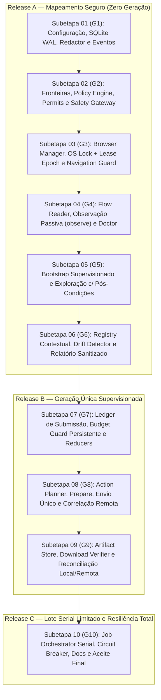

# Plano Geral Mestre — Implementação Completa do Flow Automation (`G1` a `G10`)

- **Projeto:** Flow Automation (`D:\CANAL 9\flowveo`)
- **Stack:** TypeScript (`strict: true`) + Playwright + SQLite (`WAL` + `synchronous=FULL`) + Zod + Commander + Pino + Vitest
- **Documentos-Base:** [ARCHITECTURE.md](./ARCHITECTURE.md) (v1.0) e [PRD.md](./PRD.md) (v1.0)
- **Regra de Ouro Operacional:** *Fail-Closed* absoluto + progressão sequencial estrita — **nenhuma subetapa avança para a próxima antes de 100% dos seus testes unitários, arquiteturais, de segurança, de caos e de estresse estarem verdes**.

---

## 1. Visão Geral da Estratégia de Execução

A construção do `flow-automation` é dividida em **10 Subetapas Sequenciais** correspondentes aos **10 Gates (`G1` a `G10`)** definidos na Seção 25 da Arquitetura e na Seção 20 do PRD, cobrindo as **Releases A, B e C**:

---

## 2. Mapa das 10 Subetapas (Arquivos `.md` Passo a Passo)

Cada subetapa possui um documento detalhado em `D:\CANAL 9\flowveo\docs\etapas\`:

| Subetapa | Gate | Release | Arquivo `.md` | Entregáveis de Código | Baterias de Teste Exigidas (Gate Check) |
|---|---|---|---|---|---|
| **01** | `G1` | Release A | [etapa_01_g1_fundacao_persistencia.md](./etapas/etapa_01_g1_fundacao_persistencia.md) | `package.json`, `tsconfig.json`, `config/`, Schemas Zod, SQLite (`WAL` + `FULL` + 20 tabelas), `redactor.ts`, `logger.ts`, `evidence-recorder.ts`, `event-repository.ts` | Unitários de Schema, Caos de `SQLITE_BUSY`/Disco Cheio/Falha de Sanitização, Segurança contra vazamento de tokens/cookies, Estresse de fila de escrita SQLite |
| **02** | `G2` | Release A | [etapa_02_g2_gateway_permits_fronteiras.md](./etapas/etapa_02_g2_gateway_permits_fronteiras.md) | `domain/actions/`, `domain/policies/`, `flow/contracts.ts`, `safety/policy-engine.ts`, `safety/permit-store.ts`, `safety/safety-gateway.ts`, `infrastructure/browser/authorized-executor.ts` | Arquiteturais (proibição de import Playwright fora de `infrastructure/browser`, zero `Page`/`Locator` público), Segurança (nonce único, TTL monotônico, revogação por epoch/contexto), Caos (crash após `CLAIMED`), Estresse (disputa concorrente pelo mesmo `permitId`) |
| **03** | `G3` | Release A | [etapa_03_g3_sessao_lock_navegador.md](./etapas/etapa_03_g3_sessao_lock_navegador.md) | `controller-lock.ts`, `navigation-guard.ts`, `stop-controller.ts`, `browser-manager.ts`, `flow-driver.ts` | Segurança (perfil dedicado, bloqueio de origens não autorizadas e popups, pausa em CAPTCHA/Auth), Caos (morte abrupta de owner, heartbeat vencido com processo vivo, `Ctrl+C`), Estresse (10 controladores simultâneos disputando lock de SO + SQLite lease) |
| **04** | `G4` | Release A | [etapa_04_g4_observacao_passiva_doctor.md](./etapas/etapa_04_g4_observacao_passiva_doctor.md) | `flow-reader.ts`, `passive-discovery.ts`, `mapping-service.ts` (modo `observe`), `cli/` (`doctor`, `login`, `map observe`, `policy inspect`) | Segurança (garantia de zero mutação em `observe`, bloqueio de `evaluate` arbitrário), Caos (DOM incompleto, hidratação lenta, leitura transitória com backoff/jitter), Estresse (inspeção repetida de árvores DOM densas com sanitização) |
| **05** | `G5` | Release A | [etapa_05_g5_bootstrap_exploracao_poscondicoes.md](./etapas/etapa_05_g5_bootstrap_exploracao_poscondicoes.md) | `supervised-bootstrap.ts`, `transition-validator.ts`, verificação de pós-condições (`OPEN_UI`, `CONFIGURE`, `FILL`, `UPLOAD`) | Segurança (aprovação não generaliza para botões similares, proibição de `.first()`/`.nth()`, proibição de `force: true`), Caos (clique sem pós-condição, elemento trocado entre leitura e clique, menu lento), Estresse (sequência serial de transições sob validação estrita) |
| **06** | `G6` | Release A | [etapa_06_g6_registry_contextual_drift_release_a.md](./etapas/etapa_06_g6_registry_contextual_drift_release_a.md) | `registry-validator.ts`, `drift-detector.ts`, exportação sanitizada de relatório (`map validate`, `map report`), trava absoluta da Release A (`A-18`) | Segurança (bloqueio total de `SUBMIT` na Release A mesmo alterando config/flags, export sem dados privados), Caos (mudança de locale/viewport/projeto/variante invalidando transições dependentes), Estresse (revalidação massiva de invariantes e detecção de drift) |
| **07** | `G7` | Release B | [etapa_07_g7_ledger_limites_reducers.md](./etapas/etapa_07_g7_ledger_limites_reducers.md) | `domain/jobs/`, `domain/submissions/`, `domain/results/`, `budget-guard.ts`, `submission-ledger.ts`, `state-reducers.ts` | Segurança (UUID + payload versionado, reserva antes do clique, manutenção da reserva em `UNKNOWN`), Caos (crash em cada fronteira do protocolo de envio: antes do commit, após `RESERVED`, após `DISPATCHING`, reinício mantendo limites), Estresse (rajadas de reservas concorrentes contra teto de orçamento) |
| **08** | `G8` | Release B | [etapa_08_g8_preparacao_submissao_correlacao.md](./etapas/etapa_08_g8_preparacao_submissao_correlacao.md) | `action-planner.ts`, `execution-service.ts` (`dry-run`, `prepare`, `execute` unitário), motor de correlação remota (`CONFIRMED`, `AMBIGUOUS`, `NOT_OBSERVED`) | Segurança (releitura final de projeto/modelo/prompt/quantidade antes de `SUBMIT`, zero reenvio em timeout), Caos (listagem virtualizada/parcial, dois resultados idênticos gerando `AMBIGUOUS`/`NEEDS_REVIEW`, geração manual concorrente), Estresse (planejamento e validação de invariantes sob mudanças rápidas de estado) |
| **09** | `G9` | Release B | [etapa_09_g9_artefatos_downloads_reconciliacao.md](./etapas/etapa_09_g9_artefatos_downloads_reconciliacao.md) | `artifact-store.ts`, `download-verifier.ts`, `local-reconciler.ts`, `remote-reconciler.ts`, `recovery-service.ts` (`reconcile`, `resume`, `artifacts reconcile`) | Segurança (rejeição de path traversal `../` e symlinks, execução de `ffprobe` sem shell e com timeout, cadeia obrigatória `job -> intent -> submission -> result -> artifact`), Caos (queda entre download no staging, rename atômico e commit no SQLite; arquivo órfão com nome parecido; download válido do resultado errado; resultado `READY` na retomada sem `PROCESSING` prévio), Estresse (verificação concorrente de integridade SHA-256 e reconciliação de múltiplos artefatos) |
| **10** | `G10` | Release C | [etapa_10_g10_lote_serial_guardrails_docs.md](./etapas/etapa_10_g10_lote_serial_guardrails_docs.md) | `job-orchestrator.ts` (lote serial pequeno), circuit breaker persistido, `SAFETY.md`, `MAPPING-PROTOCOL.md`, `STATE-MACHINES.md`, `RUNBOOK.md`, suíte integrada E2E | Segurança (isolamento entre jobs do lote, cancelamento local preservando ledger remoto), Caos (falhas consecutivas abrindo circuit breaker persistido entre reinícios, falha parcial de saídas múltiplas vs `CompletionPolicy`), Estresse (execução de lote completo com falhas injetadas, pausas e retomadas sem perda de guardrails) |

---

## 3. Matriz de Rastreabilidade (PRD + Arquitetura → Subetapas)

| Grupo de Requisitos | IDs | Subetapas Responsáveis |
|---|---|---|
| **Objetivos do Produto** | `OBJ-01` a `OBJ-07` | `G1` a `G10` |
| **Requisitos Release A** | `A-01` a `A-20` | `G1`, `G2`, `G3`, `G4`, `G5`, `G6` |
| **Requisitos Releases B e C** | `BC-01` a `BC-18` | `G7`, `G8`, `G9`, `G10` |
| **Segurança e Confiabilidade** | `S-01` a `S-09` | `G1` a `G10` (auditados em todas as subetapas) |
| **Tabelas SQLite (20 tabelas)** | Arquitetura §15 | Criadas em `G1` (migração inicial completa) e exercitadas em `G1`–`G10` |
| **Comandos CLI (18 comandos)** | Arquitetura §22 / PRD §14 | `G4`–`G6` (Release A: 9 comandos) e `G8`–`G10` (Releases B/C: 9 comandos) |

---

## 4. Protocolo de Validação por Subetapa (Gate Check)

Para cada subetapa `N` (`1 <= N <= 10`):
1. **Implementação:** Criação/atualização apenas dos módulos previstos na subetapa `N`.
2. **Checagem Estática Estrita:** `npm run typecheck` (`tsc --noEmit` com `strict: true`, `noUncheckedIndexedAccess: true`, `exactOptionalPropertyTypes: true`).
3. **Execução das 4 Baterias de Teste da Subetapa `N`:**
   - `tests/unit/` e `tests/architecture/` (Regras de domínio e fronteiras de importação/exportação).
   - `tests/security/` (Redação, permissões descartáveis, anti-traversal, bloqueios fail-closed).
   - `tests/chaos/` (Injeção de falhas em banco, filesystem, navegador simulado, crashes de processo e estados `UNKNOWN`).
   - `tests/stress/` (Concorrência de locks, filas seriais, limites de orçamento e carga de eventos).
4. **Regressão Acumulada:** Todos os testes das subetapas `1..N` devem passar com **0 falhas**.
5. **Registro de Gate Aprovado:** Somente após 100% de aprovação inicia-se a subetapa `N + 1`.
