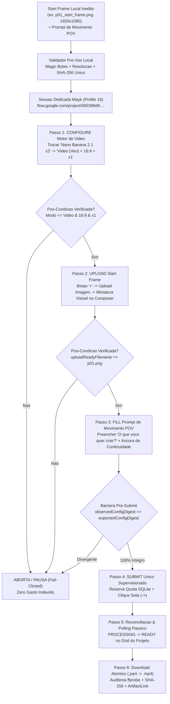

# Plano Completo — Geração de Vídeo com Start Frame no Google Flow (Estilo Firefly)

- **Versão:** 1.0
- **Projeto:** `flow-automation` (`D:\CANAL 9\flowveo`)
- **Sessão Homologada:** `Profile 18` (`EL CAZADOR DEL WINS - Mayk` / `matosmayk9@gmail.com`)
- **URL do Projeto no Flow:** `https://flow.google.com/project/560389d6-0558-4e65-8946-e48a2b12b453`
- **Paradigma:** `1 Bloco = 1 Start Frame IA Inédito (PNG/JPG) = 1 Vídeo Animado no Google Flow (MP4)` com **Fail-Closed Architecture** e **Política Zero-Reuso**.

---

## 1. Comparativo Direto: Como o Firefly Faz vs. Como o Google Flow Fará

| Etapa do Pipeline | Como o Adobe Firefly Fazia (`orquestrador_episodio_puro_firefly.py`) | Como o Google Flow Fará (`flowveo`) |
| :--- | :--- | :--- |
| **1. Entrada (Start Frame)** | PNG `1920x1080` (`16:9`) validado com `SHA-256` inédito em `start_frames/<id>.png`. | PNG/JPG `1920x1080` (`16:9`) ou `1080x1920` (`9:16`), validado por magic bytes, dimensões e `SHA-256` inédito antes de tocar no navegador. |
| **2. Seleção de Motor e Formato** | Selecionava `Kling 2.5 Turbo`, resolução `1080p`, proporção `16:9` (`Widescreen`). | No composer do Flow, abre o seletor (`🍌 Nano Banana 2.1 ▭ x2`), troca do modo Imagem (`Nano Banana`) para **Modo Vídeo (`Veo 2` / `Veo 3.1`)**, trava proporção **`16:9` (`▭`)** e quantidade **`x1`**. |
| **3. Upload do Start Frame** | Anexava a imagem no slot `First Frame` (`input[type="file"]`) do Firefly Video. | Clica no botão **`+`** (`ctrl_add_media`) à esquerda de `"O que você quer criar?"`, injeta o arquivo via `filechooser` / `input[type="file"]` e comprova a miniatura anexada no composer (`START_FRAME_UPLOADED`). |
| **4. Prompt de Movimento POV** | Prompt de movimento em inglês + `ANCORA_CONTINUIDADE_VIDEO_POV` + filtro de moderação. | Prompt de movimento POV em 1ª pessoa + `ANCORA_CONTINUIDADE_VIDEO_POV` calibrada para o Veo, verificado por igualdade exata e `promptDigestSha256` após estabilização do DOM. |
| **5. Barreira Pré-Envio e Clique** | Clicava em `Generate` após anexar imagem e colar texto. | Revalida `observedConfigDigest` (Modo Vídeo + `16:9` + `x1` + Start Frame anexado + Prompt íntegro), reserva quota no SQLite WAL e clica na seta **`→`** (`ctrl_submit`). |
| **6. Monitoramento e Download** | Polling até o card concluir e download para `renders_firefly/<id>.mp4`. | Polling passivo no grid do projeto `560389d6-0558-4e65-8946-e48a2b12b453`, download atômico via `.part`, verificação de `SHA-256` + `ffprobe` (`codec`, `width`, `height`, `durationSec`) e vínculo auditável no banco. |

---

## 2. Diagrama do Fluxo Ponta a Ponta no Google Flow

---

## 3. Divisão em 6 Subetapas de Implementação e Homologação

---

### SUBETAPA SF-1 — Validador de Start Frame Inédito e Engenharia de Prompt POV para o Flow
**Objetivo:** Garantir que nenhum vídeo seja preparado ou submetido sem um Start Frame físico válido, inédito (`SHA-256`) e sem um prompt de movimento POV consistente com o primeiro frame.

#### Passo a Passo:
1. **Criar `src/domain/media/start-frame-validator.ts`:**
   - Validar caminho seguro (bloquear Path Traversal `..`, caminhos fora do diretório autorizado ou symlinks suspeitos).
   - Validar assinatura binária real (magic bytes PNG `89 50 4E 47` ou JPEG `FF D8 FF`), tamanho mínimo (`> 10 KB`) e dimensões exatas (`1920x1080` para `16:9` ou `1080x1920` para `9:16`).
   - Calcular `startFrameSha256` e verificar unicidade no SQLite (impedindo reutilização acidental do mesmo frame em takes distintos).
2. **Criar `src/domain/media/flow-motion-prompt.ts`:**
   - Portar a âncora de continuidade visual do Firefly para o Google Flow:
     `"Strict visual continuity with the reference start frame: preserve exact photorealistic textures, character anatomy, hands, clothing, lighting direction, and environment geometry with natural progressive 24fps camera motion."`
   - Higienizar termos sensíveis que possam acionar bloqueio de política de conteúdo no motor Veo, mantendo 100% da ação POV.

#### Testes Obrigatórios da Subetapa SF-1:
- **Unitário:** Validação de PNG `1920x1080` legítimo e geração de `startFrameSha256` + prompt higienizado.
- **Segurança:** Rejeição imediata de Path Traversal (`../../Windows/System32/cmd.exe`) e de arquivo `.txt` renomeado para `.png` (magic bytes inválidos).
- **Caos:** Rejeição de imagem truncada/corrompida (`0 bytes`) ou com proporção incorreta antes de abrir o navegador.

---

### SUBETAPA SF-2 — Mapeamento e Transição `Modo Imagem (Nano Banana)` $\rightarrow$ `Modo Vídeo (Veo 16:9 x1)`
**Objetivo:** Como o Google Flow abre por padrão com o chip `🍌 Nano Banana 2.1 ▭ x2` (gerador de imagem com 2 saídas), mapear e homologar a troca obrigatória para **Modo Vídeo (`Veo`) + Proporção `16:9` + Quantidade `x1`**.

#### Passo a Passo:
1. **Inspeção e Bootstrap do Popover de Configuração (`ctrl_model_selector`):**
   - No navegador salvo do Mayk (`Profile 18`), clicar de forma supervisionada no seletor `🍌 Nano Banana 2.1 ▭ x2`.
   - Mapear os seletores internos do menu de configuração do Flow:
     - Seletor de modalidade/modelo: `Vídeo` / `Veo 2` / `Veo 3.1` (ou `Frames para vídeo`).
     - Seletor de proporção: `16:9` (`Paisagem` / `▭`).
     - Seletor de quantidade de saídas: `x1` (evitando gasto duplo `x2`).
2. **Verificação de Pós-Condição Estrita (`CONFIGURE`):**
   - Reler o chip do composer após fechar o popover e exigir que:
     - `creationMode === 'image-to-video'` (ou modelo selecionado contenha `Veo` / `Vídeo`, e **nunca** `Nano Banana`).
     - `selectedAspectRatio === '16:9'`.
     - `selectedOutputsCount === 1`.

#### Testes Obrigatórios da Subetapa SF-2:
- **Unitário:** Planejamento e execução da transição `CONFIGURE` alterando `Nano Banana 2.1 x2` para `Veo 16:9 x1`.
- **Segurança:** Bloqueio absoluto de `SUBMIT` caso o composer ainda esteja em `Nano Banana` (modo imagem) ou em `x2`/`x4` quando o job pede `1` saída.
- **Caos:** Simular falha de clique em que o menu fecha mas o modelo permanece `Nano Banana 2.1` — o executor deve abortar por falha de pós-condição (`A-11`).

---

### SUBETAPA SF-3 — Automação Segura do Upload de Start Frame no Composer (`Botão +`)
**Objetivo:** Anexar a imagem de Start Frame no composer do Google Flow e comprovar que a imagem está carregada e pronta (`START_FRAME_UPLOADED`) antes de preencher o prompt ou clicar em enviar.

#### Passo a Passo:
1. **Mapear o Fluxo de Anexo (`ctrl_add_media` / `+`):**
   - Localizar o botão **`+`** no canto inferior esquerdo do composer (`containerId: 'composer_toolbar'`).
   - Acionar o upload via API nativa do Playwright (`page.waitForEvent('filechooser')` ou `input[type="file"].setInputFiles(startFramePath)`), sem jamais deixar janela nativa do Windows (`Explorer`) aberta e travada.
2. **Comprovar Pós-Condição do Start Frame Carregado (`UPLOAD`):**
   - Aguardar o upload concluir na UI do Flow (verificando o desaparecimento de spinner/loading de upload e a presença do thumbnail/chip de imagem de referência acoplado ao composer).
   - Registrar `uploadReadyFilename` e `startFrameSha256` no `CreationSnapshot` e no cálculo do `observedConfigDigest`.

#### Testes Obrigatórios da Subetapa SF-3:
- **Unitário:** Ação `UPLOAD` atualiza `uploadReadyFilename` e altera o `observedConfigDigest`.
- **Segurança:** Bloquear `SUBMIT` de job `image-to-video` se `uploadReadyFilename` estiver `null` (impedindo gerar vídeo text-to-video puro sem o Start Frame!).
- **Caos:** Falha ou timeout no upload da imagem (ex: spinner infinito ou rejeição de formato) — o job pausa em segurança sem clicar em gerar.

---

### SUBETAPA SF-4 — Modo `prepare` Completo no Navegador Real (Start Frame + Modelo Vídeo + Prompt POV Sem Envio)
**Objetivo:** Executar o comando `flow prepare <jobId>` no navegador salvo do Mayk, deixando a cena 100% configurada na tela (Modo Vídeo + `16:9` + `x1` + Start Frame anexado + Prompt POV preenchido) com **zero submissão** para validação visual e técnica.

#### Passo a Passo:
1. **Gerar/Selecionar 1 Start Frame POV de Homologação (`1920x1080` PNG):**
   - Criar ou utilizar 1 Start Frame POV realista em `D:\CANAL 9\flowveo\runtime\staging\sf_homolog_01.png` (`1920x1080`, `16:9`).
2. **Executar o Pipeline `PREPARE` na Sessão do Mayk:**
   - Executar em sequência auditada:
     1. `CONFIGURE`: Selecionar Modo Vídeo (`Veo`) + `16:9` + `x1`.
     2. `UPLOAD`: Anexar `sf_homolog_01.png` como Start Frame no composer.
     3. `FILL`: Preencher o prompt de movimento POV na caixa `"O que você quer criar?"`.
   - Capturar screenshot de evidência (`runtime/reports/prepare-start-frame-ready.png`) e validar que `remote_submissions === 0`.

#### Testes Obrigatórios da Subetapa SF-4:
- **Unitário & Integração:** `prepare` preenche Start Frame + Modelo + Prompt e para exatamente na barreira pré-submit.
- **Segurança:** Prova de que `prepare` e `--dry-run` jamais disparam a ação `SUBMIT`.

---

### SUBETAPA SF-5 — Submissão Única Supervisionada (`SUBMIT`) e Monitoramento Passivo de Renderização
**Objetivo:** Com o `prepare` validado e autorizado, executar a submissão única do vídeo com Start Frame no Google Flow e acompanhar passivamente a geração até o estado `READY`.

#### Passo a Passo:
1. **Transição para Release B (Submissão Única Supervisionada):**
   - Atualizar `config/policy.json` e `config/defaults.json` para habilitar `releasePhase: "B"` com limites estritos (`maxSubmissionsPerRun: 1`, `maxRequestedOutputsPerRun: 1`, `maxActiveJobs: 1`).
2. **Barreira Pré-Submit e Clique em `→` (`ctrl_submit`):**
   - Revalidar `observedConfigDigest` imediatamente antes do clique (garantindo que o Start Frame continua anexado, o modo continua em Vídeo `16:9` `x1` e o prompt não sofreu truncamento).
   - Persistir `SubmissionIntent` + reservar `1` unidade no `BudgetService` antes do clique.
   - Clicar no botão `→` (`ctrl_submit`) e transitar para `SUBMITTED` (ou `UNKNOWN` em caso de timeout de rede, nunca reenviando automaticamente).
3. **Polling Passivo no Grid do Projeto (`560389d6-0558-4e65-8946-e48a2b12b453`):**
   - Observar o novo card de vídeo entrar em renderização (`PROCESSING` / percentual) até exibir o vídeo pronto (`READY`).

#### Testes Obrigatórios da Subetapa SF-5:
- **Segurança:** Qualquer divergência de `observedConfigDigest` (ex: Start Frame removido antes do clique) aborta o `SUBMIT` com `0` cliques.
- **Caos:** Timeout imediatamente após o clique em `→` marca a intenção como `UNKNOWN` e exige `reconcile` antes de qualquer novo envio.

---

### SUBETAPA SF-6 — Download Atômico (`.part` $\rightarrow$ `.mp4`), Auditoria `ffprobe` e Cadeia de Custódia
**Objetivo:** Baixar o vídeo gerado a partir do Start Frame no Google Flow, validar sua integridade técnica com `ffprobe` + `SHA-256` e registrar toda a cadeia de custódia no SQLite.

#### Passo a Passo:
1. **Download Seguro do Resultado (`DOWNLOAD`):**
   - Acionar o controle de download do card correlacionado (`MATCHED` inequívoco).
   - Salvar inicialmente em `runtime/downloads/<jobId>_0.mp4.part`.
2. **Verificação Técnica e Promoção Atômica (`ArtifactVerifier`):**
   - Calcular `SHA-256` e validar `sizeBytes > 50_000`.
   - Executar `ffprobe` via `execFile` (`shell: false`) comprovando stream de vídeo válido (`codec_name`, `width`, `height`, `duration > 0`).
   - Promover atomicamente para `runtime/artifacts/<jobId>_0.mp4` (e espelhar em `storage_local/episodios/` quando integrado ao pipeline de episódios).
   - Persistir o `ArtifactLink` completo: `jobId -> attemptId -> intentId -> submissionId -> resultId -> artifactId (SHA-256) + startFrameSha256`.

#### Testes Obrigatórios da Subetapa SF-6:
- **Unitário:** Cadeia de custódia completa incluindo o vínculo com `startFrameSha256`.
- **Caos:** Download interrompido mantém apenas `.part` (reconciliado na retomada) e nunca marca o job como `COMPLETED` sem `ffprobe` válido.
- **Estresse:** Verificação concorrente de hashes e metadados de múltiplos takes sem corrupção de banco.

---

## 4. Ordem de Execução Proposta

1. **Aprovar este plano** (ou indicar ajustes).
2. Executar **SF-1 + SF-2 + SF-3** (implementar validador de Start Frame + mapear no navegador aberto do Mayk a troca `Nano Banana -> Vídeo Veo` e o upload do Start Frame no botão `+`).
3. Executar **SF-4 (`prepare`)** no navegador do Mayk anexando 1 Start Frame real + Prompt POV sem clicar em enviar, gerando print de confirmação.
4. Executar **SF-5 + SF-6 (`run` + `download` + `ffprobe`)** para gerar e baixar o primeiro vídeo real com Start Frame no Google Flow.
